# EgyptOra — Tourism Analytics & Destination Intelligence

*Where Egypt’s Heritage Meets Data-Driven Discovery.*

**DigiLiAns Nano Degree | Data Analysis Capstone | September 2026**

## Project Overview

EgyptOra is a collaborative tourism-intelligence capstone that integrates fragmented tourism data about Egypt into an auditable decision-support workflow. The project combines Python-based data collection, cleaning and quality assurance, Power BI analytics, unsupervised machine learning, and a web-interface prototype for destination exploration.

## Business Problem

Tourism indicators, accommodation and heritage inventories, destination characteristics, climate and online-interest data are published across different sources and at different levels of detail. Comparing them without consistent definitions, source tracking and data validation can lead to misleading conclusions. EgyptOra provides a structured foundation for exploring these indicators while preserving their analytical limitations.

## Key Project Results

| Indicator | Documented result |
| --- | ---: |
| International tourist arrivals, 2025 (rounded) | 19.0 million |
| Growth from 2024, calculated using rounded arrivals | ~20.3% |
| Official open archaeological sites | 154 |
| Official open museums | 31 |
| UNESCO World Heritage site records | 7 |
| Destination reference records | 38 |
| Linked attraction records | 504 |
| Data quality checks passed | 17 / 17 |
| Destinations eligible for ML | 32 / 38 |
| Selected destination clusters | 4 |

Figures refer to the documented project data and coverage, not live tourism statistics.

## My Contribution — Abdelrahman Omar

**Machine Learning & Advanced Analytics**

- Prepared destination-level features and the modeling input.
- Applied preprocessing, feature standardization and PCA.
- Evaluated K-Means clustering candidates using Silhouette Score and Davies-Bouldin Index.
- Selected the final four-cluster segmentation and interpreted the analytical results.

Data collection, cleaning, dashboard development, data modeling, prototype design and documentation were collaborative team workstreams. See the team credits below.

## End-to-End Workflow

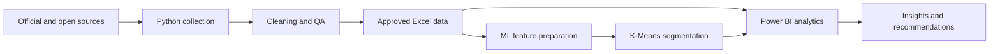

The collection workflow preserves raw source snapshots, normalized outputs, source registers, file manifests and QA checks. The cleaning workflow standardizes text, handles logical blanks conservatively and preserves verified numeric and English values. Power BI uses a consolidated analysis-ready workbook rather than appending duplicate CSV exports.

## Power BI Dashboard Gallery

### 1. Executive Overview
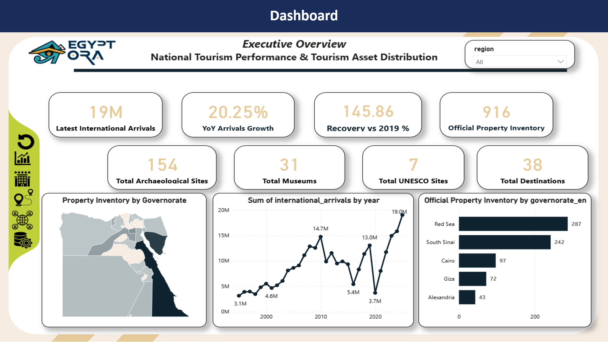

### 2. International Tourism Trend
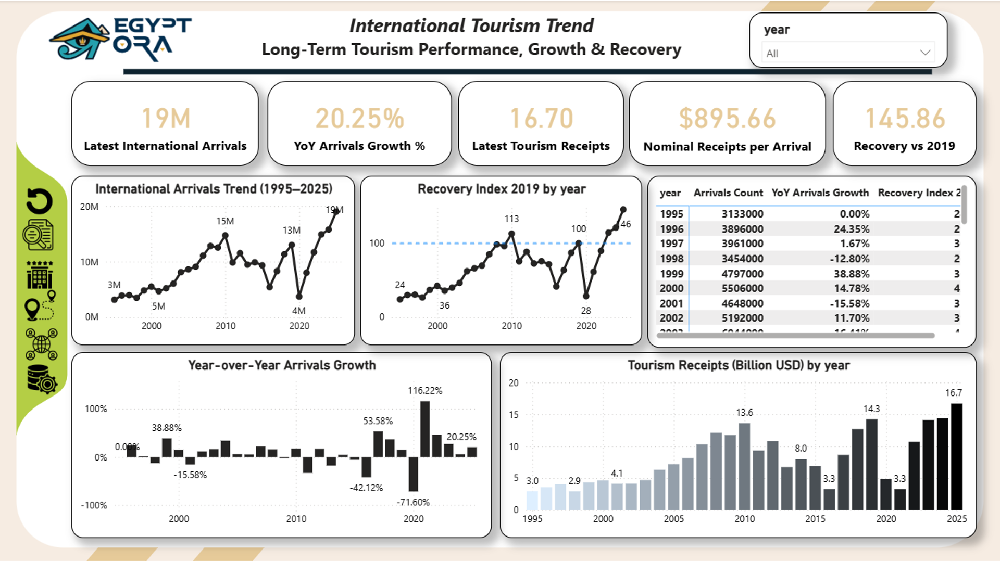

### 3. Hospitality & Heritage Landscape
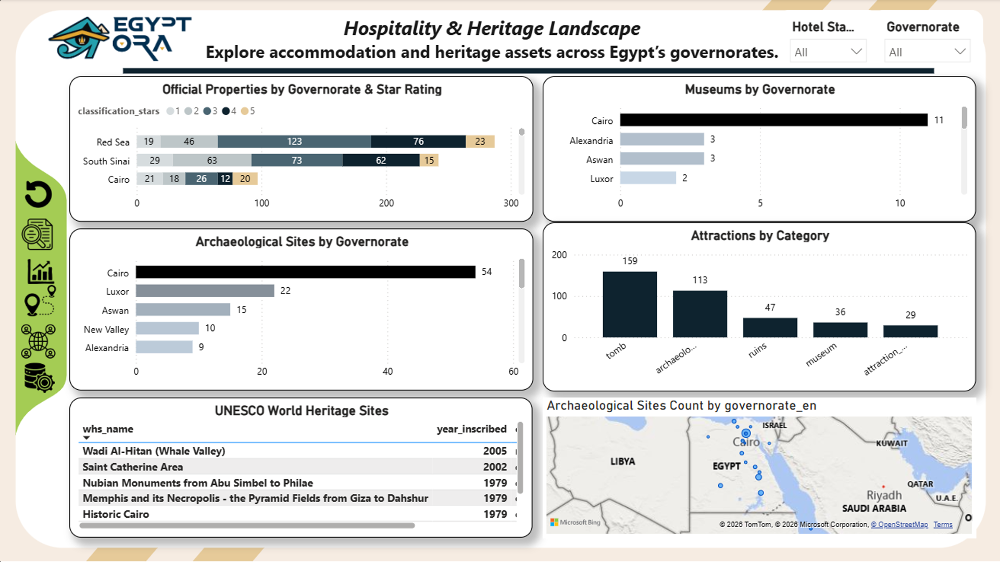

### 4. Destinations & Climate
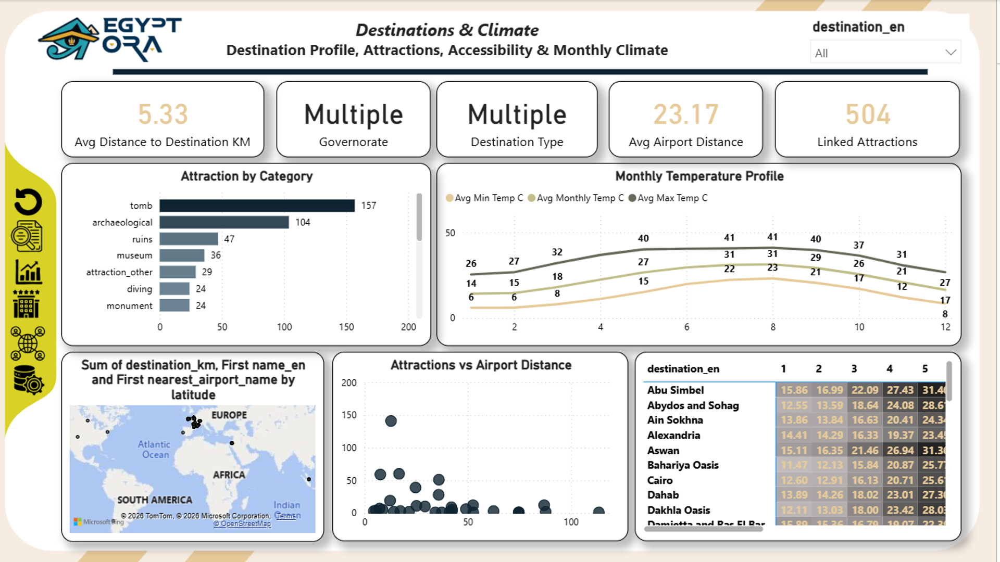

### 5. Digital Interest & Online Awareness
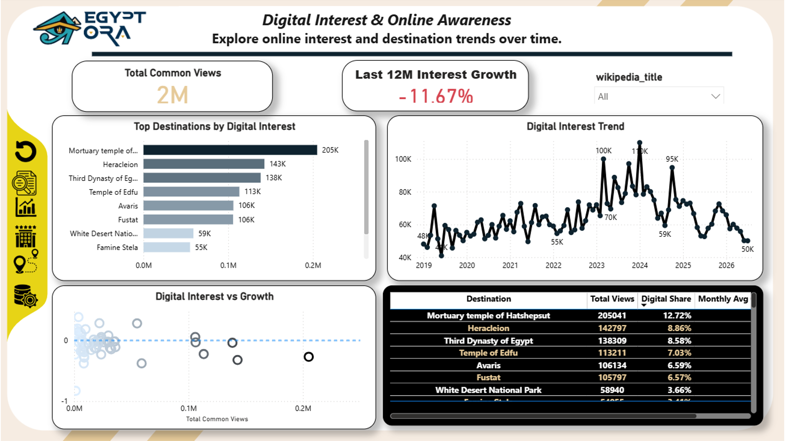

### 6. Data Quality & Source Audit
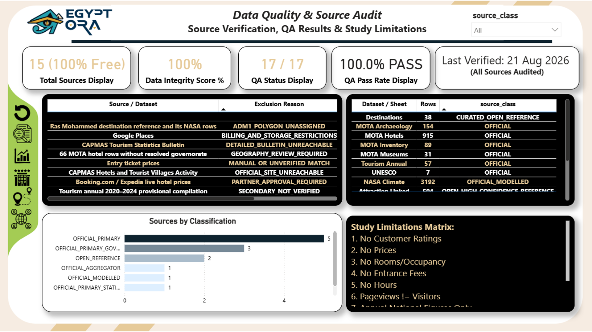

### 7. AI Destination Intelligence
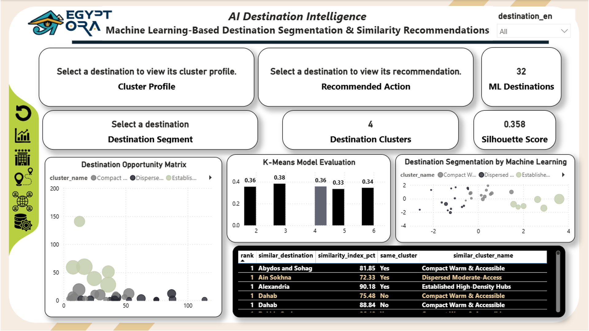

---

## Website Prototype

### Homepage
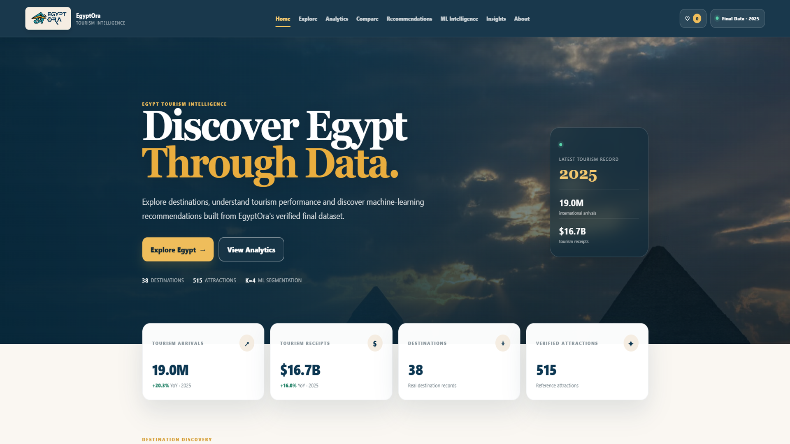

### Destination Comparison
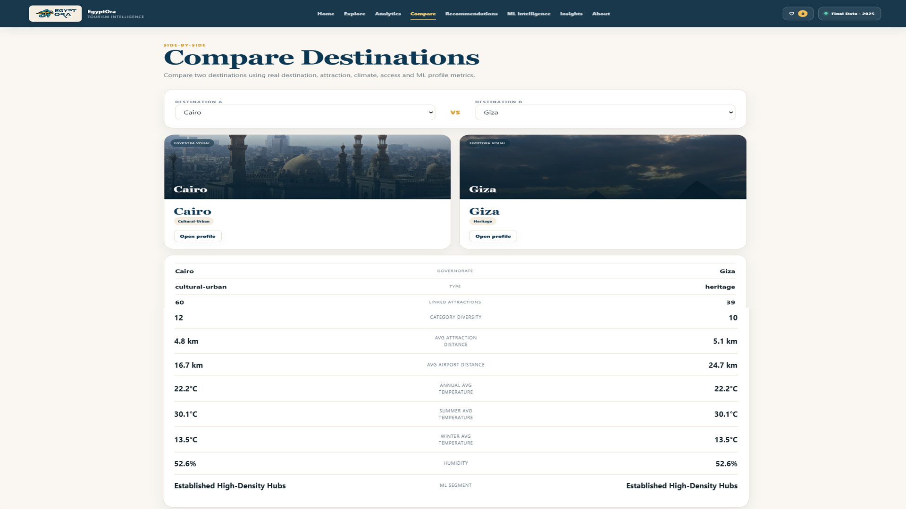

### Smart Recommendations
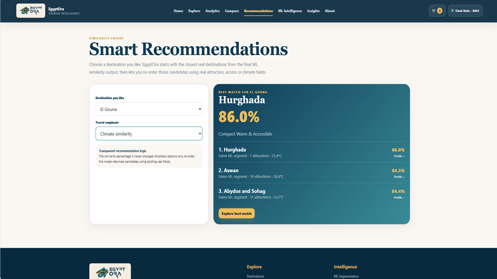

---

## Power BI Analytics

The documented report contains six core analytical pages and two additional analytical outputs:

1. Executive Overview — national trends and asset indicators.
2. International Tourism Trend — arrivals, year-over-year growth and recovery.
3. Accommodation and Heritage — official property inventory and cultural assets.
4. Destinations and Climate — attraction profiles, accessibility context and modeled climate.
5. Digital Interest — Wikimedia pageviews and coverage-aware comparisons.
6. Data Quality and Methodology — provenance, QA checks, exclusions and limitations.
7. Machine Learning — destination segmentation and model evaluation.
8. Insights and Recommendations — evidence-based findings and next steps.

## Machine Learning — Destination Segmentation

The unsupervised workflow uses five destination-level features:

- `linked_attractions`
- `category_diversity`
- `avg_attraction_distance_km`
- `avg_airport_distance_km`
- `annual_avg_temp_c`

**Pipeline:** StandardScaler → PCA (90% variance retention target) → K-Means.

| Model configuration | Documented result |
| --- | --- |
| Eligible destinations | 32 out of 38 |
| Candidate K values | 2–6 |
| Evaluation metrics | Silhouette Score, Davies-Bouldin Index |
| Selected K | 4 |
| Silhouette Score (K=4) | 0.358 |
| Silhouette Score (K=3) | 0.383 |
| Cluster sizes | 6, 6, 8, 12 |
| Random state | 42 |

K=4 was selected as a trade-off between segmentation detail and interpretability, despite K=3 having a higher reported Silhouette Score. Six destinations were excluded because required linked-attraction records were unavailable in the modeling input.

## Selected Insights

- The documented national arrivals series shows strong recovery, reaching approximately 19 million arrivals in 2025.
- Cairo, Luxor and Aswan contain notable concentrations of archaeological assets; inventory is not a measure of visitor demand.
- Luxor West Bank has 141 linked attraction records in the project dataset, compared with 60 for Cairo and 59 for Luxor East Bank.
- Wikimedia pageviews provide a measure of online attention, not physical visits. The common comparison window covers 56 titles across 25 months.
- Destination clusters support comparisons between structurally similar locations and help identify data-coverage gaps.

## Data Sources

| Provider | Use |
| --- | --- |
| Ministry of Tourism and Antiquities | Accommodation, archaeology and museum inventories |
| World Bank WDI and Egyptian government publications | Annual national tourism indicators |
| NASA POWER | Modeled destination climate |
| Wikimedia Foundation | English-language pageviews |
| geoBoundaries | Egypt ADM1 geographic boundaries |
| UNESCO World Heritage Centre | World Heritage site records |
| Wikidata and curated open references | Attraction identity and enrichment |

## Tools and Technologies

Python · Jupyter Notebook · pandas · NumPy · scikit-learn · openpyxl · requests · Microsoft Excel · Power BI · DAX · GeoJSON

## Limitations

- K-Means is descriptive segmentation, not a forecast of arrivals or tourism demand.
- Property inventories do not represent room capacity, occupancy, booking prices or customer satisfaction.
- Heritage and attraction records are asset references, not verified visitor counts.
- Wikipedia pageviews are digital-interest signals, not physical visitation.
- Modeled climate is descriptive and does not establish causality.
- The web prototype is a concept demonstration, not a verified production booking system.

## Team & Acknowledgements

Developed as a six-member team capstone in the DigiLiAns Nano Degree Data Analysis track, September 2026.

| Team member | Documented role |
| --- | --- |
| Ahmed Wael | Data Cleaning & Preparation |
| Michael Magdy | UI/UX Prototype & Quality Assurance |
| Abdelrahman Omar | Machine Learning & Advanced Analytics |
| Taha Farahat | Power BI Dashboard & Data Visualization |
| Mohamed Eid | Power BI, Tourism Analysis, Insights & Recommendations |
| Kareem Esmail | Data Modeling, Digital Analytics & Documentation |

Acknowledgement: Eng. Bassam Elshoraa and the project supervision committee.

## Portfolio

[Abdelrahman Omar — Data Analytics Portfolio](https://abdelrahman-omar-portfolio.lovable.app)

External data remains subject to the original providers' terms. No blanket redistribution license is asserted for the team project or third-party datasets.
